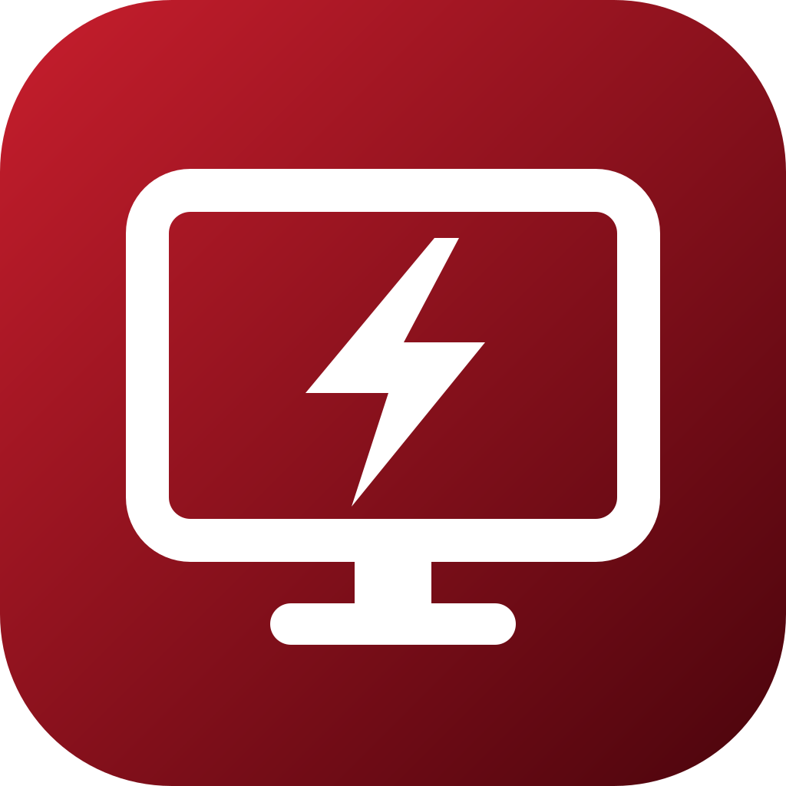

   
  <b>Ultra RustDesk</b> — a remote desktop built for direct, low-latency connections on difficult networks 
  <a href="docs/README-RU.md">Русский</a> | English

> [!Caution]
> **Use it only on devices you own or are allowed to control.** Unauthorized access to other people's
> computers is illegal. The authors are not responsible for misuse.

Ultra RustDesk is a fork of [RustDesk](https://github.com/rustdesk/rustdesk) maintained by **eturnercus**.
It keeps RustDesk's video, input, clipboard and file transfer, and replaces how two devices find and talk
to each other: direct connections come first, they are always end-to-end encrypted, and several
transports are tried in parallel so a session starts quickly even when some of them are blocked or slow.

Platforms: **Windows x64**, **Linux x86_64** (`.deb`, `.rpm`, Arch, AppImage), **Android** (arm64, armv7, x86_64, universal APK).

**Installs next to a stock RustDesk without touching it.** Everything has its own name:

| | Stock RustDesk | Ultra RustDesk |
|---|---|---|
| Windows | `C:\Program Files\RustDesk\RustDesk.exe`, service `RustDesk` | `C:\Program Files\UltraRustDesk\UltraRustDesk.exe`, service `UltraRustDesk` |
| Linux | `/usr/bin/rustdesk`, `rustdesk.service`, package `rustdesk` | `/usr/bin/ultrarustdesk`, `ultrarustdesk.service`, package `ultrarustdesk` |
| Android | `com.carriez.flutter_hbb` | `com.eturnercus.ultrarustdesk` |
| Settings | `%AppData%\RustDesk`, `~/.config/rustdesk` | `%AppData%\UltraRustDesk`, `~/.config/ultrarustdesk` |
| Links | `rustdesk://` | `ultrarustdesk://` |
| Icon | RustDesk logo | its own (a monitor with a lightning bolt) |

---

## What is different from RustDesk

| | RustDesk | Ultra RustDesk |
|---|---|---|
| Direct IP connection | **not encrypted** (only a server can vouch for keys) | always end-to-end encrypted, key pinned on first use |
| Transports for a direct connection | TCP | **QUIC and TCP raced in parallel** |
| Direct access | off by default | on by default |
| Default / maximum frame rate | 30 / 120 FPS (30 without your own server) | **60 / 144 FPS** |
| Servers | public RustDesk servers for every ID connection | **none**: never contacted unless you set your own ID server; ready at once |
| LAN devices found by discovery | connected through a server | **connected directly**, no server |
| Router port forwarding | manual | **automatic (UPnP)** |
| Self-updates from rustdesk.com | yes | **disabled** (would replace the fork) |
| Android package | `com.carriez.flutter_hbb` | `com.eturnercus.ultrarustdesk` (installs next to RustDesk) |

### End-to-end encryption with pinned keys

Upstream RustDesk trusts a peer's key only when its rendezvous server signs it, so direct IP sessions ran
in plaintext and showed an "Insecure Connection" warning. In Ultra RustDesk:

- the controlled device sends its Ed25519 public key together with its signed identity;
- the controlling device remembers that key for the address on the first connection (trust on first use,
  like SSH) and **refuses** a later connection that presents a different key;
- a session never falls back to plaintext;
- the device's own key fingerprint is always shown in **Settings → About**, so you can compare it once.

Code: [`src/ultra_pin.rs`](src/ultra_pin.rs).

### QUIC transport and parallel racing

- QUIC over UDP on the **same port** as the direct TCP listener (21118 by default).
- To the network it looks like ordinary HTTP/3 (ALPN `h3`, TLS 1.3). The QUIC certificate is throwaway;
  who the peer is gets decided by the pinned-key handshake inside, not by the certificate.
- Tuned for latency: BBR congestion control, 16/32 MB flow-control windows so a video frame never waits
  for the receiver, 4 s keep-alive so NAT mappings stay open.
- The controller starts QUIC immediately and TCP 250 ms later; the first one to finish the encrypted
  handshake wins. If UDP is blocked, this costs a quarter of a second, and only once: the winner is
  remembered per device, and where TCP won, it starts at once next time.

### LAN and UPnP

- LAN discovery replies carry the direct port. A device found on the **LAN** tab is connected
  directly even when you click it by ID; its signed ID must match, and its key is pinned under that ID.
- While direct access is on, the app asks the router (UPnP IGD) to forward the direct port, TCP and
  UDP, and writes the external address to the log. Set the option `enable-ultra-upnp` to `N` to turn
  it off.

Code: [`src/ultra_upnp.rs`](src/ultra_upnp.rs), `try_lan_direct` in [`src/ultra_pin.rs`](src/ultra_pin.rs).

Code: [`libs/hbb_common/src/quic.rs`](libs/hbb_common/src/quic.rs), `connect_direct` in
[`src/ultra_pin.rs`](src/ultra_pin.rs), `direct_server` in [`src/rendezvous_mediator.rs`](src/rendezvous_mediator.rs).

### Low latency

- 60 FPS for every new viewer by default, up to 144 FPS; quality and FPS are never capped to 30.
- Network QoS still lowers the frame rate on a slow link and raises it back.
- RustDesk's hardware encoders/decoders stay enabled in the builds.

---

## All the ways a connection is made

No servers are involved in any of them. Whatever you type, every candidate address is tried at
once, and on every address QUIC (UDP) and TCP are raced; the first to finish the encrypted handshake
wins. Nothing waits forever: after 15 seconds you get an error, and the log says why.

| You type / pick | Addresses tried | Works |
|---|---|---|
| A device on the **LAN** tab (by ID) | its LAN addresses from discovery | same network |
| **Connection code** `UR…` (or its QR) | LAN IPv4 + public IPv4 (UPnP, only if really public) + global IPv6 | same network; from the internet when the PC has a public IPv4 or IPv6 |
| **IPv4 address**, e.g. `192.168.1.20`, `203.0.113.7:21118` | that address | where it is reachable |
| **IPv6 address**, e.g. `2a01:db8::7`, `[2a01:db8::7]:21118` | that address | where IPv6 reaches it; often works without a public IPv4 |
| **Host name**, e.g. `myhost.example.com` or `myhost.example.com:21118` | every IPv6 and IPv4 address in DNS | as above |
| A plain **ID** not on the LAN | none (no servers); you are told to use the code or an address | — |

**IPv6.** The PC listens on IPv6 for both TCP and QUIC and puts its global IPv6 address in the
connection code. Routers usually block incoming IPv6, so the app asks the router (UPnP IGDv2
`WANIPv6FirewallControl`) to open the port for this address; if the router cannot, the log says
so, and the port has to be allowed in the router's IPv6 firewall by hand.

**VPN, Xray and similar.** Ultra RustDesk has no built-in proxy protocols. If a VPN or Xray client
runs on the device in system / TUN mode, Ultra RustDesk simply uses that network like any other
program; the PC must still be reachable at the address you connect to.

### Connection log

**Connection log** (the terminal icon next to the connection code on the PC, in the app bar on the
phone, and a button in every connection error) shows each step live: which address and transport
was tried, how long it took and why it failed, which ports this device listens on, what the router
answered over UPnP, incoming attempts and password login results. `timed out` means packets do not
get through (closed port, NAT or firewall), `refused` means nothing listens there, `SECURITY` means
the key did not match. Copy it with one button to send it to whoever helps you.

## How to connect

1. **Install** Ultra RustDesk on both devices.
2. On the device you want to control, make sure **TCP and UDP port 21118** are reachable from the other
   device: same LAN, a public/IPv6 address, or a port forward on the router (done automatically when
   the router supports UPnP). On a LAN you can also just pick the device on the **LAN** tab.
3. On the controlling device, type the address into the ID field: `192.168.1.20`, `203.0.113.7:21118` or
   `myhost.example.com:21118`, and connect.
4. **First connection:** a dialog shows a 6-digit pairing code. The remote device shows its own code
   as the first 6 digits of its fingerprint in *Settings → About*. Press **Continue** only if they
   match; **Disconnect** forgets the key.
5. The connection window shows which transport won (`QUIC` or `TCP`).

### From a phone, with a connection code and a password

1. On the PC: **Settings → Security → Set permanent password**.
2. On the PC: open **Settings → About** and copy the **Connection code** (`UR…`). It contains the PC's
   addresses (LAN, public IPv4 from UPnP, global IPv6), the direct port and a hash of the PC's key.
   Under the code the PC says whether it works from the internet or only inside this network.
3. On the phone: type the code into the ID field, connect and enter the password. The key is checked
   against the code, so no pairing dialog appears. All addresses are tried at once; if none answers
   within 15 seconds you get an error saying so, not an endless wait.

Typing a plain ID works only for devices on the **LAN** tab: no servers are used, so for anything else
the app tells you at once to use the connection code or an IP address.

The code changes when your provider gives the PC a new external address; copy it again then. Without
UPnP the code holds the LAN address and works only inside that network. Behind carrier-grade NAT (no
public address) the PC cannot be reached from outside.

If the remote device was reinstalled, its key changes and the connection is refused. Open the device's
menu (⋮) in the Recent / Favorites / LAN list and choose **Forget pinned key**, then connect again.
The keys live in `ultra_pins.json` in the config folder (Windows: `%AppData%\UltraRustDesk\config\`,
Linux: `~/.config/ultrarustdesk/`), separate from a stock RustDesk's settings.

---

## Downloads and builds

Builds are made by GitHub Actions ([`.github/workflows/ultra-build.yml`](.github/workflows/ultra-build.yml)):

- **Actions → Ultra RustDesk Build → Run workflow** builds everything and publishes it to the
  `ultra-nightly` release;
- pushing a tag like `v1.5.1-ultra.1` publishes a release with that name.

Building locally follows the upstream instructions: <https://rustdesk.com/docs/en/dev/build/>.
Ultra RustDesk needs **Rust 1.85 or newer** (QUIC library).

---

## Current limitations

- If **both** devices are behind carrier-grade NAT (typical for mobile internet), a direct connection is
  impossible. The same usually applies to connecting **to** a phone over mobile internet.
- Direct mode does not interoperate with stock RustDesk: a stock client cannot complete the encrypted
  handshake, by design.
- Windows ships as an `.exe` installer only; the upstream MSI is not built, because its WiX project
  installs a product named RustDesk.

## Roadmap

| Transport / feature | Status |
|---|---|
| TCP direct, end-to-end encrypted, pinned keys | ✅ done |
| QUIC direct (HTTP/3-like, BBR), raced against TCP | ✅ done |
| 60 FPS default, 144 FPS max | ✅ done |
| Direct connection to LAN-discovered devices; remembering the winning transport | ✅ done |
| UPnP port forwarding | ✅ done |
| "Forget pinned key" in the device menu | ✅ done |
| Upstream self-update disabled | ✅ done |
| Pairing code confirmation on the first connection | ✅ done |
| Own name everywhere (service, folders, packages, links) and own icon | ✅ done |
| Connection code (all addresses + key hash) instead of an ID | ✅ done |
| Serverless by default: public servers never contacted | ✅ done |
| IPv6 direct (TCP + QUIC), all DNS addresses raced, router IPv6 pinhole | ✅ done |
| Live connection log | ✅ done |
| Obfuscated QUIC inspired by Hysteria2 | not started |
| TLS 1.3 over TCP 443 | not started |
| WebSocket through a CDN | not started |
| Switching transport without dropping the session | not started |

Design notes: [`docs/ULTRA_DESIGN.md`](docs/ULTRA_DESIGN.md).

---

## License and credits

Ultra RustDesk is distributed under the **GNU AGPL-3.0**, like RustDesk ([LICENCE](LICENCE)).

- Fork and changes: **eturnercus**
- Based on RustDesk, © Purslane Tech Pte. Ltd. and contributors — <https://github.com/rustdesk/rustdesk>
- QUIC: [quinn](https://github.com/quinn-rs/quinn). The planned obfuscated transport borrows ideas from
  [Hysteria](https://github.com/apernet/hysteria) (MIT) and is not wire-compatible with it.
