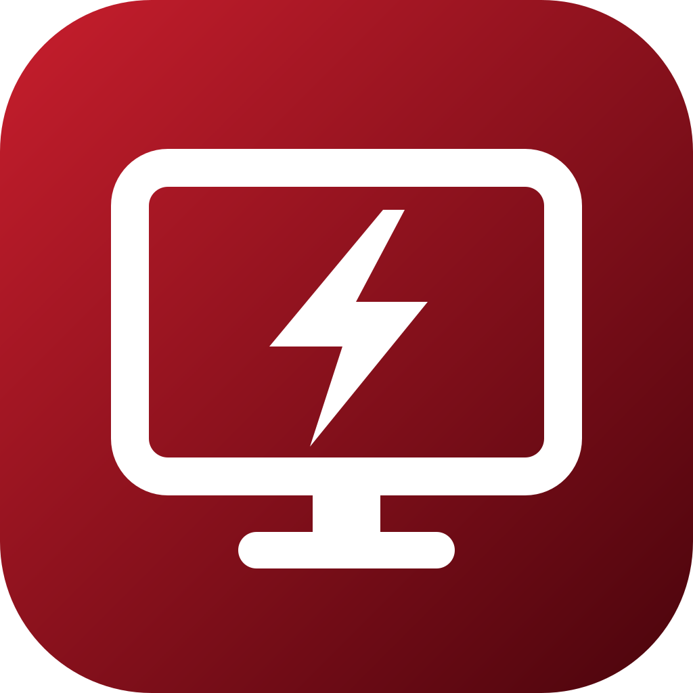

   
  <b>Ultra RustDesk</b> — удалённый рабочий стол для прямых подключений с минимальной задержкой в сложных сетях 
  Русский | <a href="../README.md">English</a>

> [!Caution]
> **Используйте программу только на своих устройствах или там, где вам разрешено управление.**
> Несанкционированный доступ к чужим компьютерам незаконен. Авторы не отвечают за злоупотребления.

Ultra RustDesk — форк [RustDesk](https://github.com/rustdesk/rustdesk), автор форка **eturnercus**.
Видео, управление, буфер обмена и передача файлов остались от RustDesk. Заменено то, как два устройства
находят друг друга и обмениваются данными: в приоритете прямые подключения, они всегда шифруются
end-to-end, а несколько транспортов пробуются параллельно, поэтому сеанс начинается быстро, даже если
часть из них заблокирована или работает медленно.

Платформы: **Windows x64**, **Linux x86_64** (`.deb`, `.rpm`, Arch, AppImage), **Android** (arm64, armv7, x86_64, универсальный APK).

**Ставится рядом с обычным RustDesk и никак его не задевает.** У всего своё имя:

| | Обычный RustDesk | Ultra RustDesk |
|---|---|---|
| Windows | `C:\Program Files\RustDesk\RustDesk.exe`, служба `RustDesk` | `C:\Program Files\UltraRustDesk\UltraRustDesk.exe`, служба `UltraRustDesk` |
| Linux | `/usr/bin/rustdesk`, `rustdesk.service`, пакет `rustdesk` | `/usr/bin/ultrarustdesk`, `ultrarustdesk.service`, пакет `ultrarustdesk` |
| Android | `com.carriez.flutter_hbb` | `com.eturnercus.ultrarustdesk` |
| Настройки | `%AppData%\RustDesk`, `~/.config/rustdesk` | `%AppData%\UltraRustDesk`, `~/.config/ultrarustdesk` |
| Ссылки | `rustdesk://` | `ultrarustdesk://` |
| Иконка | логотип RustDesk | своя (монитор с молнией) |

---

## Чем отличается от RustDesk

| | RustDesk | Ultra RustDesk |
|---|---|---|
| Прямое подключение по IP | **без шифрования** (ключи может подтвердить только сервер) | всегда end-to-end, ключ закрепляется при первом подключении |
| Транспорты прямого подключения | TCP | **QUIC и TCP параллельно** |
| Прямой доступ | выключен по умолчанию | включён по умолчанию |
| Частота кадров по умолчанию / максимум | 30 / 120 FPS (30 без своего сервера) | **60 / 144 FPS** |
| Серверы | публичные серверы RustDesk для каждого подключения по ID | **никаких**: программа к ним не обращается, пока вы не укажете свой сервер ID; готова сразу |
| Устройства, найденные в локальной сети | подключение через сервер | **напрямую**, без сервера |
| Проброс порта на роутере | вручную | **автоматически (UPnP)** |
| Самообновление с rustdesk.com | есть | **отключено** (заменило бы форк) |
| Пакет Android | `com.carriez.flutter_hbb` | `com.eturnercus.ultrarustdesk` (ставится рядом с RustDesk) |

### Шифрование end-to-end с закреплением ключей

В оригинальном RustDesk ключ собеседника считается доверенным, только если его подписал сервер.
Поэтому прямые сеансы по IP шли открытым текстом с предупреждением «Insecure Connection».
В Ultra RustDesk:

- **Управляемое устройство** отправляет свой публичный ключ Ed25519 вместе с подписанным удостоверением.
- **Управляющее устройство** при первом подключении запоминает ключ для этого адреса (как в SSH) и
  **отклоняет** следующее подключение, если ключ другой.
- **Без шифрования** сеанс не продолжится ни при каких условиях.
- **Отпечаток собственного ключа** всегда виден в **Настройки → О программе**, по нему можно один раз сверить устройство.

Код: [`src/ultra_pin.rs`](../src/ultra_pin.rs).

### QUIC и параллельный выбор транспорта

- **QUIC по UDP** работает на **том же порту**, что и прямой TCP (по умолчанию 21118).
- **Для сети** трафик выглядит как обычный HTTP/3 (ALPN `h3`, TLS 1.3). Сертификат QUIC одноразовый,
  а подлинность собеседника проверяется внутренним рукопожатием с закреплённым ключом.
- **Настройки под минимальную задержку:**
  - управление перегрузкой BBR;
  - окна 16/32 МБ, чтобы кадр видео не ждал получателя;
  - keep-alive каждые 4 секунды, чтобы NAT не закрывал соединение.
- **Выбор транспорта:** QUIC стартует сразу, TCP через 250 мс, и побеждает тот, кто первым завершит
  зашифрованное рукопожатие. Если UDP заблокирован, это стоит четверть секунды, и только один раз:
  победитель запоминается для каждого устройства, и если победил TCP, в следующий раз он стартует сразу.

### Локальная сеть и UPnP

- **Обнаружение в локальной сети** сообщает порт прямого доступа. Устройство из вкладки
  **«Локальная сеть»** подключается напрямую, даже если кликнуть его по ID. Подписанный ID должен
  совпасть, а ключ закрепляется за этим ID.
- **UPnP:** пока включён прямой доступ, программа просит роутер пробросить порт прямого доступа
  (TCP и UDP) и пишет внешний адрес в журнал. Отключается опцией `enable-ultra-upnp` = `N`.

Код: [`src/ultra_upnp.rs`](../src/ultra_upnp.rs), `try_lan_direct` в [`src/ultra_pin.rs`](../src/ultra_pin.rs).

Код: [`libs/hbb_common/src/quic.rs`](../libs/hbb_common/src/quic.rs), функция `connect_direct` в
[`src/ultra_pin.rs`](../src/ultra_pin.rs), `direct_server` в [`src/rendezvous_mediator.rs`](../src/rendezvous_mediator.rs).

### Минимальная задержка

- **60 FPS** по умолчанию для каждого нового зрителя, максимум **144 FPS**. Ограничения в 30 FPS нет.
- **На медленной сети** QoS снижает частоту кадров и возвращает её обратно, когда сеть восстановится.
- **Аппаратное кодирование и декодирование** RustDesk в сборках сохранено.

---

## Все способы подключения

Ни в одном из них серверы не участвуют. Что бы вы ни ввели, все подходящие адреса пробуются
одновременно, и на каждом адресе одновременно идут QUIC (UDP) и TCP; побеждает тот, кто первым
завершит зашифрованное рукопожатие. Бесконечного ожидания нет: через 15 секунд будет ошибка, а в
журнале видно, почему.

| Что вводите / выбираете | Какие адреса пробуются | Где работает |
|---|---|---|
| Устройство из вкладки **«Локальная сеть»** (по ID) | его адреса в локальной сети | в той же сети |
| **Код подключения** `UR…` (или его QR) | локальный IPv4 + публичный IPv4 (UPnP, только если он правда публичный) + глобальный IPv6 | в той же сети; из интернета, если у ПК есть публичный IPv4 или IPv6 |
| **IPv4-адрес**, например `192.168.1.20`, `203.0.113.7:21118` | этот адрес | где он доступен |
| **IPv6-адрес**, например `2a01:db8::7`, `[2a01:db8::7]:21118` | этот адрес | где до него доходит IPv6; часто работает и без публичного IPv4 |
| **Имя хоста**, например `myhost.example.com` или `myhost.example.com:21118` | все IPv6- и IPv4-адреса из DNS | как выше |
| Обычный **ID** не из локальной сети | никаких (серверов нет); программа подскажет ввести код или адрес | — |

**IPv6.** ПК слушает IPv6 и по TCP, и по QUIC и кладёт свой глобальный IPv6-адрес в код
подключения. Роутеры обычно закрывают входящий IPv6, поэтому программа просит роутер (UPnP IGDv2
`WANIPv6FirewallControl`) открыть порт для этого адреса. Если роутер не умеет, это будет видно в
журнале, и порт надо разрешить в IPv6-фаерволе роутера вручную.

**VPN, Xray и подобное.** Встроенных прокси-протоколов в Ultra RustDesk нет. Если VPN или клиент
Xray работает на устройстве в системном режиме / режиме TUN, Ultra RustDesk просто пользуется этой
сетью, как любая программа; при этом ПК всё равно должен быть доступен по адресу, к которому вы
подключаетесь.

### Журнал подключения

**Журнал подключения** (значок терминала рядом с кодом подключения на ПК, кнопка в верхней панели на
телефоне и кнопка в каждом окне ошибки подключения) показывает каждый шаг в реальном времени: какой
адрес и транспорт пробовался, сколько это заняло и почему не вышло, какие порты слушает это
устройство, что ответил роутер по UPnP, входящие попытки и результат входа по паролю. `timed out` —
пакеты не доходят (порт закрыт, NAT или фаервол), `refused` — там ничего не слушает, `SECURITY` —
ключ не совпал. Журнал копируется одной кнопкой, чтобы отправить тому, кто помогает разобраться.

## Как подключиться

1. **Установите** Ultra RustDesk на оба устройства.
2. **На устройстве, которым будете управлять,** порт **21118 по TCP и UDP** должен быть доступен со
   второго устройства. Подойдёт одна локальная сеть, публичный или IPv6-адрес либо проброс порта на
   роутере (делается автоматически, если роутер поддерживает UPnP). В локальной сети можно просто
   выбрать устройство во вкладке **«Локальная сеть»**.
3. **На управляющем устройстве** введите адрес в поле ID и подключитесь. Например: `192.168.1.20`,
   `203.0.113.7:21118` или `myhost.example.com:21118`.
4. **При первом подключении** появится окно с 6-значным кодом. Удалённое устройство показывает свой
   код первыми 6 цифрами отпечатка в *Настройки → О программе*. Нажимайте **«Продолжить»**, только
   если коды совпадают. **«Отключиться»** забывает ключ.
5. **В окне подключения** видно, какой транспорт победил: `QUIC` или `TCP`.

### С телефона по коду подключения и паролю

1. **На ПК:** **Настройки → Безопасность → Установить постоянный пароль**.
2. **На ПК:** откройте **Настройки → О программе** и скопируйте **Код подключения** (`UR…`). В нём
   все адреса ПК (локальный, публичный IPv4 от UPnP, глобальный IPv6), порт прямого доступа и
   хеш ключа ПК. Под кодом ПК пишет, работает ли он из интернета или только в этой сети.
3. **На телефоне:** введите код в поле ID, подключитесь и введите пароль. Ключ проверяется по коду,
   поэтому окно сверки 6 цифр не появится. Все адреса пробуются одновременно; если за 15 секунд
   ни один не ответил, будет понятная ошибка, а не бесконечное ожидание.

Обычный ID работает только для устройств из вкладки **«Локальная сеть»**: серверы не используются,
поэтому для остальных программа сразу подскажет ввести код подключения или IP-адрес.

Код меняется, когда провайдер выдаёт ПК новый внешний адрес: тогда скопируйте его заново. Без UPnP
в коде будет адрес в локальной сети, и он сработает только внутри неё. Если ПК за NAT оператора
(нет публичного адреса), снаружи до него не достучаться.

Если удалённое устройство переустановили, его ключ изменится, и подключение будет отклонено.
Откройте меню устройства (⋮) в списке «Недавние», «Избранное» или «Локальная сеть», выберите
**«Забыть закреплённый ключ»** и подключитесь снова. Ключи хранятся в `ultra_pins.json` в папке
настроек: Windows — `%AppData%\UltraRustDesk\config\`, Linux — `~/.config/ultrarustdesk/`.
Эта папка отдельная от настроек обычного RustDesk.

---

## Загрузка и сборка

Сборку делает GitHub Actions ([`.github/workflows/ultra-build.yml`](../.github/workflows/ultra-build.yml)):

- **Actions → Ultra RustDesk Build → Run workflow** собирает всё и выкладывает в релиз `ultra-nightly`;
- **тег** вида `v1.5.1-ultra.1` создаёт релиз с этим именем.

Локальная сборка делается по инструкции RustDesk: <https://rustdesk.com/docs/en/dev/build/>.
Для Ultra RustDesk нужен **Rust 1.85 или новее**: его требует библиотека QUIC.

---

## Текущие ограничения

- **Обе стороны за NAT оператора** (обычное дело для мобильного интернета): прямое подключение
  невозможно. Обычно это касается и подключения **к** телефону через мобильный интернет.
- **С обычным RustDesk** прямой режим несовместим: стандартный клиент не пройдёт зашифрованное
  рукопожатие. Так задумано.
- **Windows:** только установщик `.exe`. MSI из RustDesk не собирается: его проект WiX устанавливает
  продукт с именем RustDesk.

## Планы

| Транспорт / функция | Статус |
|---|---|
| Прямой TCP, end-to-end, закреплённые ключи | ✅ готово |
| Прямой QUIC (как HTTP/3, BBR), параллельно с TCP | ✅ готово |
| 60 FPS по умолчанию, максимум 144 | ✅ готово |
| Прямое подключение к устройствам из локальной сети; запоминание лучшего транспорта | ✅ готово |
| Проброс порта через UPnP | ✅ готово |
| «Забыть закреплённый ключ» в меню устройства | ✅ готово |
| Самообновление с rustdesk.com отключено | ✅ готово |
| Подтверждение кода при первом подключении | ✅ готово |
| Своё имя везде (служба, папки, пакеты, ссылки) и своя иконка | ✅ готово |
| Код подключения (все адреса + хеш ключа) вместо ID | ✅ готово |
| Без серверов по умолчанию: к публичным серверам не обращается | ✅ готово |
| Прямой IPv6 (TCP + QUIC), все адреса из DNS параллельно, открытие IPv6 на роутере | ✅ готово |
| Журнал подключения в реальном времени | ✅ готово |
| QUIC с маскировкой по мотивам Hysteria2 | не начато |
| TLS 1.3 по TCP 443 | не начато |
| WebSocket через CDN | не начато |
| Смена транспорта без разрыва сеанса | не начато |

Заметки по архитектуре: [`docs/ULTRA_DESIGN.md`](ULTRA_DESIGN.md).

---

## Лицензия и авторы

Ultra RustDesk распространяется под **GNU AGPL-3.0**, как и RustDesk ([LICENCE](../LICENCE)).

- **Форк и изменения:** **eturnercus**
- **Основа:** RustDesk, © Purslane Tech Pte. Ltd. и участники — <https://github.com/rustdesk/rustdesk>
- **QUIC:** [quinn](https://github.com/quinn-rs/quinn). Планируемый транспорт с маскировкой берёт идеи
  [Hysteria](https://github.com/apernet/hysteria) (MIT) и не совместим с ним на уровне протокола.
